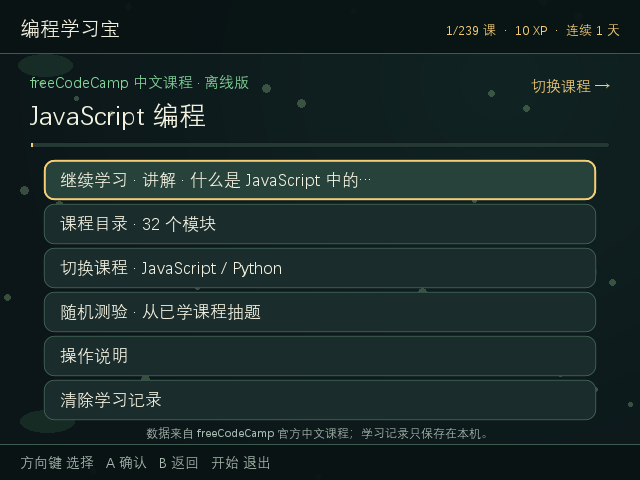
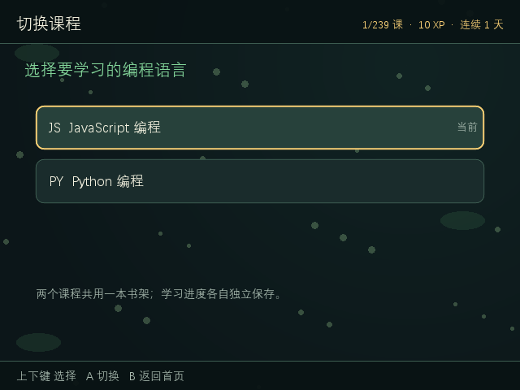
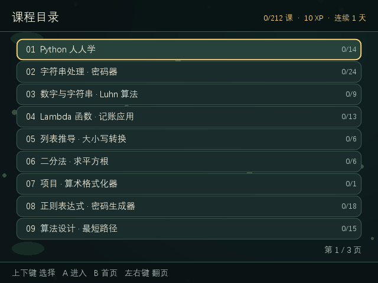
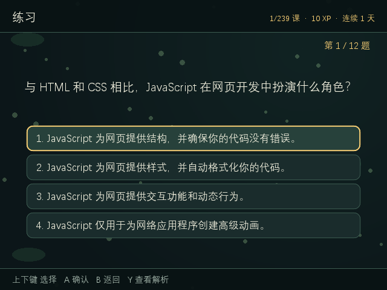

# Code Buddy · 编程学习宝

一个完全离线的编程课程阅读 + 自测应用，基于 **Godot 3.5.3** 构建，画面 640×480 横屏。为 R36S 等开源掌机（PortMaster）设计，也能用键盘在 PC 上直接运行。

课程来自 [freeCodeCamp](https://www.freecodecamp.org/) 官方中文课程（i18n-curriculum），目前收录两门：

- **JavaScript 编程**（javascript-v9）：1406 课 / 1020 题 / 32 模块
- **Python 编程**（Python 人人学 + 用 Python 做科学计算）：815 课 / 56 题 / 20 模块



## 这是什么，不是什么

它是一个**离线课程阅读 + 自测器**：可以读讲解、看示例代码、做选择题、记录本地进度。

它**不是**离线版 freeCodeCamp：不能在线写代码跑测试、不能提交项目、不能考试认证、没有视频和论坛。这些功能依赖 freeCodeCamp 的服务器，离线掌机上无法提供。

## 功能

- **课程切换**：一个应用内切换 JavaScript / Python，两套进度各自独立保存
- **课程目录**：按模块分页浏览，显示每个模块的完成度
- **阅读页面**：讲解正文 + 代码块，自动分页适配小屏
- **互动测验**：选择题即时判定，答错显示正确答案与解析
- **随机测验**：从已学课程抽题复习
- **本地进度**：完成记录、最佳成绩、XP、连续学习天数，只保存在本机





## 重要：课程数据需要你自行生成

本仓库**不包含** freeCodeCamp 课程内容。freeCodeCamp 的软件代码是 BSD-3-Clause，但 `/curriculum` 下的学习资源版权归 freeCodeCamp.org 所有，README 未给出宽松的再分发条款。因此仓库只公开抽取脚本和应用代码，课程 JSON 由使用者从官方仓库本地生成。

生成步骤（在 **PC** 上运行，掌机只消费最终数据）：

```bash
# 1. 下载官方 i18n-curriculum 中文课程（约 20MB），放到 ../.build/fcc/i18n-curriculum.zip
#    地址：https://github.com/freeCodeCamp/i18n-curriculum  (main 分支 zip)

# 2. 下载三个 superblock 结构文件到 ../.build/fcc/（raw.githubusercontent.com）：
#    curriculum/structure/superblocks/javascript-v9.json
#    curriculum/structure/superblocks/python-for-everybody.json
#    curriculum/structure/superblocks/scientific-computing-with-python.json

# 3. 抽取成 data/curriculum.json
python tools/extract_all.py

# 4. 重建中文与音标字体子集（需要 fontTools；字体取自 Windows 系统字体）
python tools/prepare_fonts.py
```

生成的数据约 1.9 MB，包含课程树、讲解正文、题目与答案。

## 运行

### PC（Godot 3.5.3）

用 Godot 3.5.3 打开 `project.godot` 按 F5，或命令行：

```bash
godot --path .
```

### 掌机（PortMaster）

将 `code-buddy.pck`、`code-buddy.gptk`、`code-buddy.sh` 放入
`/roms/ports/code-buddy/`，通过 PortMaster 菜单启动。

## 操作

| 功能 | 键盘 | 手柄 |
| --- | --- | --- |
| 移动 / 选择 | W A S D、方向键 | 方向键 / 左摇杆 |
| 确认 / 下一页 / 下一题 | J、空格、回车 | A |
| 返回 | K、Esc | B |
| 跳到练习 / 上一页 | L | X |
| 查看解析 / 下一页 | U | Y |
| 上一页 / 下一页 | Q / R | L1 / R1 |
| 回到首页 | P | Select |
| 退出 | Esc | Start |

掌机按键映射见 [`code-buddy.gptk`](code-buddy.gptk)。

## 项目结构

```
code-buddy/
├── data/curriculum.json          # 课程数据（由抽取脚本生成，不入库）
├── scripts/
│   ├── App.gd                    # 页面流程、课程切换、答题
│   ├── CurriculumRepository.gd   # 多课程数据层（tracks）
│   ├── ProgressStore.gd          # 本地进度
│   ├── UIKit.gd / Chrome.gd      # 控件与页眉页脚
├── scenes/Main.tscn              # 主场景
├── assets/fonts/                 # ui.ttf 中文子集、ipa.ttf 音标
├── tools/
│   ├── extract_all.py            # 从 freeCodeCamp 抽取两门课程
│   ├── extract_curriculum.py     # Markdown 解析与题目提取
│   ├── prepare_fonts.py          # 字体子集生成
│   ├── smoke.gd                  # 冒烟测试
│   └── render_all.gd             # 页面截图
└── docs/screenshots/             # 示例截图
```

## 开发与测试

```bash
# 冒烟测试：数据完整性、课程切换、答题、存档
godot --path . -s tools/smoke.gd

# 渲染全部页面到 .build/screenshots/
godot --path . -s tools/render_all.gd

# 导出 PCK
godot --path . --export-pack "Linux/X11" .build/code-buddy.pck
```

## 存档

进度保存在 Godot 用户目录下的 `code_buddy_profile.json`（Windows 通常为
`%APPDATA%/Godot/app_userdata/Code Buddy/`）。首页"清除学习记录"可以重置。

## 协议

应用与抽取脚本：[MIT](LICENSE) © 2026 liangdabiao

课程内容版权归 freeCodeCamp.org 所有，请遵守其使用条款。
